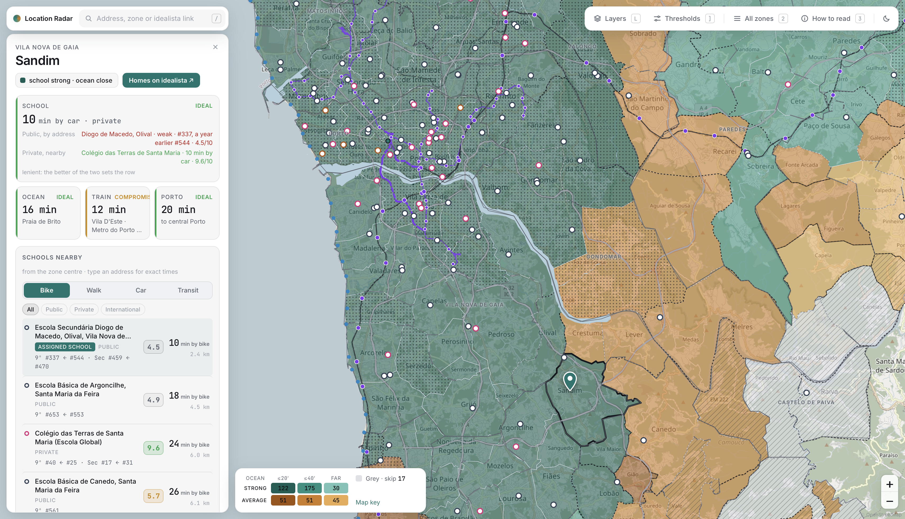

# Escolas do Porto

An interactive map for one question: **is a house in this zone worth a look, and how good is the location?**

**Live:** https://angel-zero-star.github.io/escola-porto/

---

## The problem

House hunting around Porto means comparing ~500 zones on things no listing site shows together: which public school your address is actually assigned to (and how good it is), whether there's a decent private school nearby, how far the ocean is, and how long it takes to reach a train or the city. Answering that for one zone takes an evening of research. For 491 zones it needs a tool.

## What it does

- **Search an address** — type a street (or paste an idealista area link) and a pin drops on it; the zone opens and everything is measured from the house: the drive to the beach, the station and Porto, and the schools around it.
- **Map of 491 idealista zones**, full screen, coloured by two things in a fixed order: first the school situation, then distance to the ocean. Colour is an order, not a score — any zone with a strong school beats any zone with an average one. Rivers, the coast, school dots (public, private, international), stations and the metro lines under construction are drawn on top.
- **The place panel** — four signals (school, ocean, train, Porto), with the school signal spelled out: the public school assigned to the address, the nearest good private school, and which of the two set the result.
- **Schools nearby** — the closest schools with real route times by bike, on foot or by car, and a public-transport link for each. The assigned school always comes first.
- **One school score, 1–10** — every Portuguese-curriculum school, public or private, scored from its place in Público's national exam ranking. International schools sit other exams, so they show what they're recognised by (IB, Cambridge, AEFE, the German schools-abroad network) and any results they publish.
- **Thresholds** — school rank cut-offs, minutes to a private school, the ocean, a station and Porto, combined by a *lenient / strict* switch. The map recolours instantly and the legend shows how many zones moved.
- **All zones** — every zone in a sortable, filterable table, plus a how-to-read page with the method and sources.

## How it works

- **School rank uses the worse of two years.** Público's ranking moves a lot between editions (the median school shifts ~115 places), so a school only counts as strong if it cleared the bar in both.
- **Only the school you're actually zoned for counts.** Portuguese enrolment gives priority to your own cluster's school; a strong school next door in another cluster doesn't help, so it's shown in the card but doesn't colour the map.
- **Private schools have no rank cut-off** — almost all already sit near the top nationally — except the few ranked below the "grey" line.
- **Drive times** for the colours are precomputed car minutes without traffic, from each zone to its schools, the nearest Atlantic beach, the nearest suburban-rail or metro station, and a reference point in Porto. For a searched address, the beach, station, Porto and the nearby schools are routed live from the house.
- **Services:** addresses are geocoded with Photon and routes come from OSRM on FOSSGIS's servers, both built on OpenStreetMap data; the basemap is OpenStreetMap.

## Data

- Zones: idealista; parish boundaries from the official CAOP.
- Schools: Público's 2025 school rankings (9th grade and secondary), school-cluster catchments from the Ministry of Education's data and school websites.
- Beaches, stations and roads: OpenStreetMap.

Everything is baked into the single HTML file; the map uses [Leaflet](https://leafletjs.com/).

## Built with

- One self-contained HTML file: plain JavaScript and Leaflet, dark by default with a light mode.
- Designed and directed by me; built with **Claude Code**. I set the questions, the criteria and their order, and the design direction (a dark, full-screen map with the selected place as the hero); Claude Code did the data research and the implementation, with sources and a confidence level recorded for each school catchment, and we iterated on screenshots I reviewed on localhost.
- The map colours were checked for colour-blind readers, and the 1–10 score and every catchment rule are explained in the app itself.
- The demo video on my portfolio is rendered with Remotion driving the real app frame by frame.

## Notes

Catchment areas change and some zones span two school clusters — for a specific address, confirm with the school. Drive times exclude traffic. OpenStreetMap doesn't have every house number, so some addresses are matched to the street.
